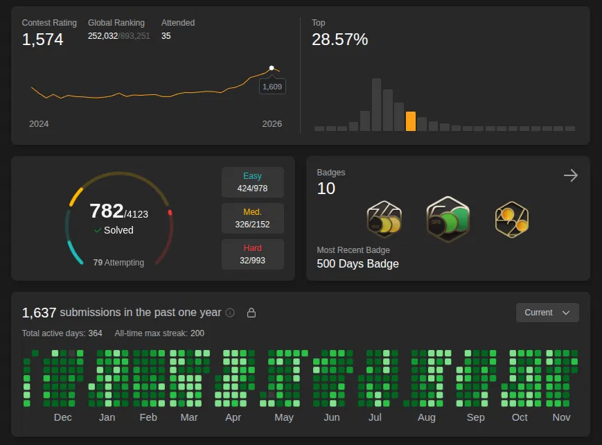
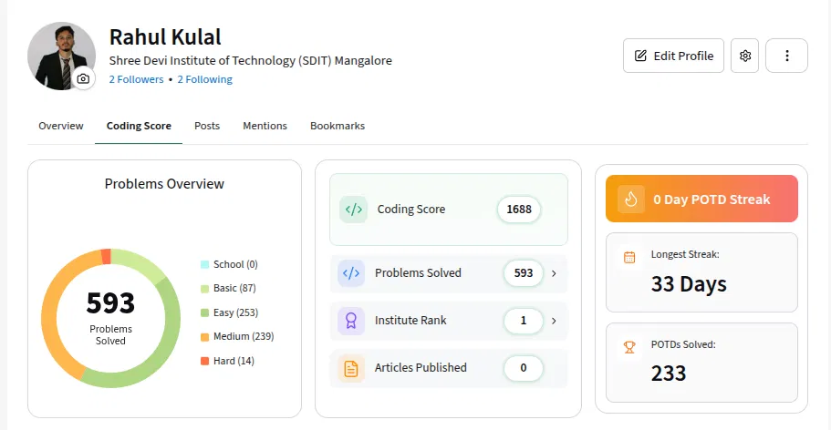

  

 

## 💻 Coding Profiles

<table>
  <tr>
    <td width="50%" valign="top">
      
    </td>
    <td width="50%" valign="top">
      
    </td>
  </tr>
</table>

**Building. Learning. Solving. Improving.** 🚀

